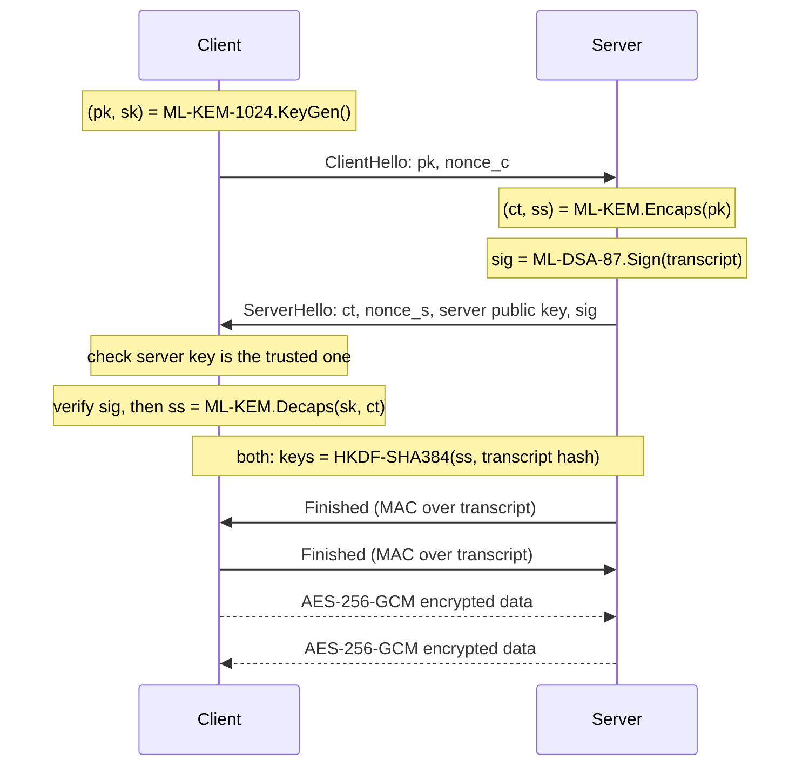

# Post-Quantum Handshake (ML-KEM-1024)

A small, working version of the "handshake" that starts every secure internet connection (the part of HTTPS/TLS that sets up the secret keys), rebuilt so that it stays secure **even against a future quantum computer**.

It uses **one** post-quantum algorithm suite throughout: **ML-KEM-1024** for key exchange, **ML-DSA-87** for signatures, **HKDF-SHA384** for key derivation and **AES-256-GCM** for encryption. This is the same suite the US NSA requires for its own systems (CNSA 2.0).

*Course project · Cryptography · ABV-IIITM Gwalior · October 2026*

> ⚠️ This is a learning and research project. Never use it to protect real data.

---

## Contents

1. [The problem in one minute](#1-the-problem-in-one-minute)
2. [What our professor asked for](#2-what-our-professor-asked-for)
3. [Background: the building blocks](#3-background-the-building-blocks)
4. [How the handshake works](#4-how-the-handshake-works)
5. [What's in this repository](#5-whats-in-this-repository)
6. [Run it yourself](#6-run-it-yourself)
7. [What the demo shows](#7-what-the-demo-shows)
8. [How we know it works: the tests](#8-how-we-know-it-works-the-tests)
9. [What quantum safety costs](#9-what-quantum-safety-costs)
10. [Code walkthrough](#10-code-walkthrough)
11. [Limitations](#11-limitations)
12. [FAQ](#12-faq)
13. [Glossary](#13-glossary)
14. [References](#14-references)

---

## 1. The problem in one minute

Whenever you open a website over HTTPS, your browser and the server first agree on a secret key that only the two of them know. Everything afterwards is encrypted with that key.

Today that agreement usually uses **elliptic-curve cryptography** (for example X25519). It is perfectly safe against normal computers. But a large enough **quantum computer** running **Shor's algorithm** could break it in hours, and making the keys bigger doesn't help.

Quantum computers that big don't exist yet, so why worry now? Because of **"harvest now, decrypt later"**: an attacker can record encrypted traffic today and simply wait. Once a quantum computer exists, they break the recorded key exchange and read everything. Secrets that must stay secret for years are already at risk.

So the key exchange must be replaced **now** with algorithms that quantum computers can't break. NIST standardised these in 2024: **ML-KEM** (FIPS 203) and **ML-DSA** (FIPS 204).

## 2. What our professor asked for

Our first plan copied what Chrome and Cloudflare do: a **hybrid** that runs classical X25519 *and* post-quantum ML-KEM-768 together, so an attacker has to break both.

Our professor's advice was to use **one** scheme instead, made strong enough on its own to stop **both** classical and quantum attacks.

That decides the choice for us:

- **X25519 can't be that scheme.** Shor's algorithm breaks elliptic curves at *every* key size, so there's no "strong enough" version of it.
- **ML-KEM can.** It is built on lattice problems, which have no known fast quantum attack, and which are also hard for classical computers.

So we kept only the post-quantum side and pushed it to its **highest security level**:

| Part | Old plan (hybrid) | New design (single scheme) |
|---|---|---|
| Key exchange | X25519 + ML-KEM-768 | **ML-KEM-1024** (NIST Category 5, the highest) |
| Server signature | Ed25519, later ML-DSA-65 | **ML-DSA-87** (Category 5) |
| Key derivation / hashing | HKDF-SHA256 / SHA-256 | **HKDF-SHA384 / SHA-384** |
| Encryption | AES-256-GCM | AES-256-GCM (already quantum-safe) |

**The honest trade-off:** a hybrid still protects you if someone someday finds a flaw in ML-KEM itself; a single scheme doesn't. We reduce that risk by using the largest parameter set, standard well-tested libraries, and a fixed suite that can't be downgraded. The full argument is in [`justification.md`](justification.md).

## 3. Background: the building blocks

You don't need to know the maths. Here is what each piece does.

### Classical vs quantum attackers

| Attacker | Example | What they can break |
|---|---|---|
| **Classical** | Today's computers and supercomputers | Nothing here, if the parameters are big enough |
| **Quantum** | A future large quantum computer | **Shor's algorithm** breaks RSA, Diffie-Hellman and elliptic curves completely. **Grover's algorithm** only halves the strength of AES and hashes, so AES-256 still has about 128-bit strength |

### ML-KEM: agreeing on a secret

A **KEM** (Key Encapsulation Mechanism) works like a lockbox:

1. The client creates a **key pair**: a public key `pk` (an open padlock it can hand out) and a secret key `sk` (the only key that opens it).
2. The server takes `pk`, creates a random 32-byte secret `ss`, locks it with the padlock, and sends back the locked box, called the **ciphertext** `ct`.
3. The client opens the box with `sk` and gets the same `ss`.

An eavesdropper sees `pk` and `ct` but can't recover `ss`.

ML-KEM's security rests on **Module Learning With Errors**, a lattice problem. The best known attacks on ML-KEM-1024 need roughly **2^256** operations on a normal computer and about **2^232** on a quantum one. Both are far beyond anything physically possible.

A useful bonus is **implicit rejection**: if an attacker modifies `ct`, the client doesn't get an error that could leak information. It just gets a useless random secret, and the handshake fails later.

### ML-DSA: proving who the server is

A KEM alone doesn't stop a **man-in-the-middle**: someone who sits between you and the server and runs a separate key exchange with each side. To stop that, the server **signs** the conversation with its ML-DSA-87 private key. The client checks the signature against the server's known public key. A forged message or an impostor server fails this check.

### HKDF: turning one secret into many keys

The 32-byte `ss` is never used as a key directly. **HKDF-SHA384** stretches it into separate keys for each direction of traffic and for the "Finished" checks. Each key is also mixed with a hash of every handshake message, called the **transcript**. If an attacker changed even one byte anywhere, the two sides end up with different keys and the handshake fails.

### AES-256-GCM: encrypting the actual data

After the handshake, messages are encrypted and authenticated with **AES-256-GCM**. Every message carries a hidden sequence number, so a replayed, dropped or reordered message is rejected.

## 4. How the handshake works

One round trip, just like TLS 1.3:



Step by step:

1. **ClientHello.** The client makes a fresh ML-KEM-1024 key pair for this connection, and sends the public key plus a random nonce.
2. **ServerHello.** The server encapsulates a secret to that public key, picks its own nonce, **signs** everything so far with ML-DSA-87, and sends the ciphertext, its nonce, its public key and the signature.
3. **Client checks.** The client checks that the server's public key is the one it trusts (it is "pinned", standing in for a certificate). It then verifies the signature and decapsulates to get the same secret.
4. **Key schedule.** Both sides run HKDF-SHA384 on the secret and the transcript hash to get identical traffic keys.
5. **Finished.** Each side sends a MAC over the transcript, which proves it derived the same keys and saw the same messages.
6. **Encrypted data.** From here everything is AES-256-GCM.

There is **no algorithm negotiation**: the suite is fixed, so an attacker has nothing weaker to downgrade to.

## 5. What's in this repository

```
.
├── README.md                                   ← you are here
├── justification.md                            ← why one PQ scheme instead of the hybrid
├── presentation-guide.md                       ← talk track and likely questions for the presentation
├── Post-Quantum Handshake (ML-KEM-1024).pptx   ← project slides
├── run-tests.cmd                               ← Windows: double-click to run all tests
├── run-demo.cmd                                ← Windows: double-click to run the live demo
└── pq-handshake/                               ← the code
    ├── kex.py            ML-KEM-1024 wrapper (keygen / encaps / decaps)
    ├── auth.py           ML-DSA-87 wrapper (keygen / sign / verify)
    ├── kdf.py            HKDF-SHA384 key schedule and Finished MACs
    ├── transcript.py     running SHA-384 hash of all handshake messages
    ├── messages.py       wire format: frames, ClientHello, ServerHello
    ├── record.py         AES-256-GCM encryption with sequence numbers
    ├── client.py         client side of the handshake + command-line client
    ├── server.py         server side of the handshake + command-line server
    ├── backend.py        picks liboqs or the pure-Python fallback
    ├── demo.py           live demo: one honest handshake + four attacks
    ├── requirements.txt
    └── tests/            35 automated tests (unit + end-to-end)
```

## 6. Run it yourself

You need **Python 3.10 or newer** (we used 3.12).

### Step 1: get the code

```bash
git clone https://github.com/sudu787/postquantum_hybrid.git
cd postquantum_hybrid/pq-handshake
```

### Step 2: install the dependencies

It's best to use a virtual environment so nothing is installed system-wide.

**Windows (PowerShell):**

```bash
python -m venv .venv
.venv\Scripts\python.exe -m pip install -r requirements.txt
```

Then use `.venv\Scripts\python.exe` wherever the commands below say `python`.

**macOS / Linux:**

```bash
python3 -m venv .venv
source .venv/bin/activate
pip install -r requirements.txt
```

This installs:

- `cryptography`, for HKDF, SHA-384 and AES-GCM
- `kyber-py` and `dilithium-py`, pure-Python implementations of ML-KEM and ML-DSA (FIPS 203/204)
- `pytest`, to run the tests

> **Windows tip:** if you see `DLL load failed ... The filename or extension is too long`, the folder path is too long. Clone the repo into a short path such as `C:\code\` and try again.

### Step 3: run the tests

```bash
python -m pytest tests -v
```

All **35 tests** should pass in about 15–20 seconds.

### Step 4: run the live demo

```bash
python demo.py
```

It pauses after each step; press Enter to continue. Use `python demo.py --no-pause` to run it straight through.

### Step 5 (optional): run a real client and server

In one terminal:

```bash
python server.py
```

In a second terminal, from the same folder:

```bash
python client.py --message "hello"
```

The client should print `handshake OK` and `reply: server got: hello`. The server writes its public key to `server_pk.bin`, and the client reads that file to know which server to trust. Stop the server with Ctrl+C.

### Optional: the faster liboqs backend

The pure-Python libraries are correct but slow, and they are not constant-time. For real benchmarks, install [`liboqs-python`](https://github.com/open-quantum-safe/liboqs-python), which needs the native liboqs C library. The code switches to it automatically when it is installed. To force the pure-Python backend anyway, set `PQ_BACKEND=pure`.

## 7. What the demo shows

`demo.py` puts an "attacker" between the client and the server who can read, change or replay every message. Abridged output:

```
1. Honest handshake (an eavesdropper records everything)
  client -> server  ClientHello   1,607 bytes
  server -> client  ServerHello   8,830 bytes
  server -> client  Finished         48 bytes
  client -> server  Finished         48 bytes
  client sent    : Exam answers: ML-KEM-1024 resists Shor
  eavesdropper saw: db496c1a8446ca515eeb3851ed0a6c3c...  (54 bytes of ciphertext)
  plaintext visible on the wire? False

2. Man-in-the-middle: attacker answers with its OWN server key
  client: REJECTED -> unknown server identity (public key not pinned)

3. Tampering: flip ONE bit of the ML-KEM-1024 ciphertext in transit
  client: REJECTED -> server signature does not verify

4. Downgrade: rewrite the ClientHello to ask for a weaker suite
  server: REJECTED -> unsupported version/suite 1/0x0512

5. Replay: record an honest session, then resend the client's messages
  server: REJECTED -> client Finished MAC is wrong

Summary
  Man-in-the-middle    BLOCKED
  Tampering            BLOCKED
  Downgrade            BLOCKED
  Replay               BLOCKED
```

| Attack | What the attacker tries | What stops it |
|---|---|---|
| Eavesdropping | Read the traffic | ML-KEM-1024 key exchange + AES-256-GCM |
| Man-in-the-middle | Pretend to be the server with its own key | The pinned server key + ML-DSA-87 signature |
| Tampering | Flip a bit in the ciphertext | The signature covers every handshake byte |
| Downgrade | Ask for weaker ML-KEM-512 | Fixed suite: the server refuses anything else |
| Replay | Resend an old recorded session | Fresh nonce and ciphertext each time, so old Finished MACs fail |

## 8. How we know it works: the tests

There are **35 automated tests** in three files.

| File | What it tests |
|---|---|
| `tests/test_primitives.py` | ML-KEM-1024 and ML-DSA-87 give the correct sizes and round-trip; implicit rejection; smaller (ML-KEM-512) keys are refused; AES-GCM records can't be tampered with or replayed |
| `tests/test_handshake.py` | Full handshakes in one process: matching keys, tampering of each message, MITM, downgrade |
| `tests/test_e2e.py` | **End-to-end:** the real `server.py` and `client.py` as separate programs over TCP, with a man-in-the-middle proxy |

The end-to-end tests also check:

- five clients in a row against one server
- the plaintext never appears anywhere on the wire
- the exact message sizes
- tampering with *any* handshake message or encrypted record
- a replayed recorded session
- an impostor server
- garbage input (empty connections, HTTP requests, absurd lengths, truncated messages)
- clients that connect and say nothing

These tests found **two real bugs** in our first server, which we fixed:

1. **Denial of service:** one silent client could freeze the server for everyone. The server now handles each client in its own thread and drops idle ones after a timeout.
2. **Socket leak:** after rejecting a tampered message, the server forgot to close the connection, so the client hung forever. The connection is now always closed.

## 9. What quantum safety costs

Computation is cheap; the real cost is **bytes**:

| Item | Classical (X25519 / Ed25519) | ML-KEM-768 / ML-DSA-65 | **Ours: ML-KEM-1024 / ML-DSA-87** |
|---|---|---|---|
| Key share (public key) | 32 B | 1,184 B | **1,568 B** |
| Ciphertext | 32 B | 1,088 B | **1,568 B** |
| Signature | 64 B | 3,309 B | **4,627 B** |
| Shared secret | 32 B | 32 B | **32 B** |

Our whole handshake is about **10.5 KB** (1,607 B ClientHello + 8,830 B ServerHello + two 48 B Finished messages), compared with a few hundred bytes classically. Most of that is the ML-DSA-87 signature and public key. Measuring how this behaves on slow or lossy networks is the next phase of the project (see the slides).

## 10. Code walkthrough

A good reading order, about 500 lines in total:

1. **`kex.py` and `auth.py`.** Thin wrappers around ML-KEM-1024 and ML-DSA-87. They check every length, so a wrong-sized (weaker) key is rejected before it is used.
2. **`messages.py`.** How bytes go on the wire. Each message is `type (1 byte) | length (4 bytes) | payload`. `ClientHello.decode` and `ServerHello.decode` reject any other version, suite or field size.
3. **`transcript.py`.** A running SHA-384 over every handshake message.
4. **`kdf.py`.** The key schedule: `HKDF-Extract(ss)`, then `HKDF-Expand` with labels and the transcript hash into client and server keys, IVs and Finished keys.
5. **`server.py` → `run_server()`.** The server's steps in order, each commented. Then **`client.py` → `run_client()`**, its mirror image.
6. **`record.py`.** AES-256-GCM with an implicit sequence number XORed into the nonce, which is how replays get caught.
7. **`demo.py`.** Shows how the pieces are attacked. The `Attacker` class is a tiny relay that can read and rewrite frames.

We **never implement the cryptographic maths ourselves**. Only the protocol is our code; ML-KEM, ML-DSA, HKDF and AES come from established libraries.

## 11. Limitations

- **Not for real use.** This is a teaching implementation and has not been audited.
- **The pure-Python ML-KEM/ML-DSA is not constant-time.** It could leak secrets through timing on a shared machine. Use liboqs for anything serious.
- **No certificates.** The client "pins" the server's public key from a file instead of validating a certificate chain.
- **Simplified TLS.** There is no session resumption, no key update, no client authentication, and one fixed suite.
- **No classical fallback.** If ML-KEM itself were ever broken, this design has no second layer. This is the trade-off described in [section 2](#2-what-our-professor-asked-for).

## 12. FAQ

**Why not just use a bigger elliptic curve or RSA key?**
Shor's algorithm breaks them in polynomial time, so bigger keys only slow a quantum computer down slightly. No classical size is quantum-safe.

**Isn't a hybrid safer? Chrome uses one.**
A hybrid also protects you if ML-KEM turns out to have a flaw. Our professor asked for a single scheme, and NSA's CNSA 2.0 makes the same choice, requiring pure ML-KEM-1024. We discuss the trade-off openly in [`justification.md`](justification.md).

**Why 1024 and not 768?**
ML-KEM-768 is NIST Category 3 (about as hard as breaking AES-192). ML-KEM-1024 is Category 5 (about AES-256). It gives the most safety margin if lattice attacks improve, for only a few hundred extra bytes.

**Does a quantum computer break AES-256 or SHA-384?**
No. Grover's algorithm only gives a square-root speed-up. AES-256 keeps about 128-bit strength and SHA-384 about 192-bit collision resistance, both far out of reach.

**What happens if someone changes the ciphertext?**
ML-KEM's implicit rejection gives the client a random, useless secret instead of an error. In our protocol the server's signature catches the change even earlier.

**Why is the ServerHello so big?**
It carries the 2,592-byte ML-DSA-87 public key and the 4,627-byte signature. Post-quantum signatures are large. One research direction is KEMTLS, which authenticates with a KEM instead of a signature.

## 13. Glossary

| Term | Meaning |
|---|---|
| **KEM** | Key Encapsulation Mechanism: one side locks a random secret to the other side's public key |
| **ML-KEM** | Module-Lattice KEM, NIST FIPS 203 (formerly CRYSTALS-Kyber) |
| **ML-DSA** | Module-Lattice Digital Signature Algorithm, NIST FIPS 204 (formerly CRYSTALS-Dilithium) |
| **NIST Category 5** | The highest NIST security level, at least as hard to break as AES-256 |
| **CNSA 2.0** | NSA's Commercial National Security Algorithm Suite 2.0 |
| **Shor's algorithm** | Quantum algorithm that breaks RSA, Diffie-Hellman and elliptic curves |
| **Grover's algorithm** | Quantum search algorithm that roughly halves symmetric key strength |
| **HKDF** | HMAC-based Key Derivation Function: turns one secret into many keys |
| **Transcript** | Running hash of every handshake message; binds keys to exactly what was sent |
| **Finished MAC** | A message authentication code over the transcript proving both sides agree |
| **Nonce** | A random value used once, so every session is unique |
| **AES-GCM** | Authenticated encryption: it encrypts data and detects any change to it |
| **MITM** | Man-in-the-middle: an attacker relaying and changing traffic between two parties |
| **Downgrade attack** | Forcing the two sides to use a weaker algorithm |
| **Replay attack** | Resending previously recorded messages |
| **Harvest now, decrypt later** | Recording encrypted traffic today to decrypt it once quantum computers exist |

## 14. References

- NIST **FIPS 203**, *Module-Lattice-Based Key-Encapsulation Mechanism Standard* (ML-KEM), August 2024.
- NIST **FIPS 204**, *Module-Lattice-Based Digital Signature Standard* (ML-DSA), August 2024.
- NSA, *Commercial National Security Algorithm Suite 2.0 (CNSA 2.0)*, 2022.
- RFC 8446, *The Transport Layer Security (TLS) Protocol Version 1.3*.
- RFC 5869, *HMAC-based Extract-and-Expand Key Derivation Function (HKDF)*.
- P. W. Shor, *Polynomial-Time Algorithms for Prime Factorization and Discrete Logarithms on a Quantum Computer*, SIAM Journal on Computing, 1997.
- Open Quantum Safe project: [liboqs](https://github.com/open-quantum-safe/liboqs).
